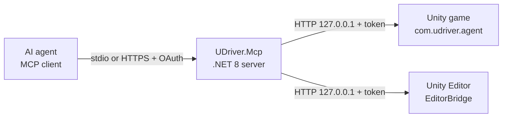

<div align="center">

# Unity MCP Driver

**Let an AI agent see, play and debug your Unity game — through the Model Context Protocol.**


</div>

Unity MCP Driver (UDriver) connects any MCP-capable AI agent to a running Unity game or the Unity Editor.
The agent can read the UI tree, click buttons, type text, take screenshots, read logs and exceptions,
inspect live object state, record frames, profile, run tests and build — and back every verdict with evidence
instead of guessing.

It works with both **UI Toolkit** and **uGUI**, in **Play Mode, Edit Mode and standalone builds**.

---

## Contents

- [How it works](#how-it-works)
- [Features](#features)
- [Quick start](#quick-start)
- [Tools](#tools-51)
- [Security](#security)
- [Configuration](#configuration)
- [Extending](#extending)
- [Known limitations](#known-limitations)
- [Uninstall](#uninstall)
- [License](#license)

## How it works



| Part | What it is |
|---|---|
| `com.udriver.agent/` | Unity package. Runs a small HTTP endpoint on `127.0.0.1` inside the game or editor. |
| `UDriver.Mcp/` | MCP server. Speaks MCP to the agent and routes calls to the game or the editor. |
| `UDriver.command` | macOS one-click launcher with a web control panel and optional remote access. |
| `setup-local.sh` / `setup-local.cmd` | Local setup for an agent running on the same machine. |

## Features

- **See the screen** — full UI tree with stable element ids, element search, screenshots with id overlays, hit-testing.
- **Act like a player** — click, hover, drag, scroll, focus, type, press keys, or drive the Input System's virtual mouse and keyboard.
- **Investigate without trusting the UI** — query logs, exceptions and UI events; read and write any object through reflection paths.
- **Set your own probes** — watches, method traces (Harmony), triggers, frame-by-frame recording, time control.
- **Measure** — profiler counters and top memory consumers.
- **Drive the editor** — enter Play Mode, compile, run EditMode/PlayMode tests, build, open scenes, query assets.
- **Build → launch → verify loop** — `editor_build`, `app_launch`, run a scenario, return a verdict.
- **Safe by default** — localhost only, per-run token, sandboxed reflection, allow-listed paths and launch arguments.

## Quick start

### Requirements

- Unity **6000.0** or newer
- .NET **8** SDK (the macOS launcher installs it for you)
- An MCP client (for example Claude, Claude Code, or any other MCP-capable agent)

### Option A — agent on the same computer

1. Copy `com.udriver.agent` into your Unity project's `Packages/` folder.
2. Build the server and get a ready-to-paste config:

   ```bash
   sh setup-local.sh
   ```

   On Windows run `setup-local.cmd`.
3. Add the printed command or JSON block to your MCP client. For Claude Code it looks like:

   ```bash
   claude mcp add udriver -e UDRIVER_BUILDS_DIR="/path/to/udriver/Builds" -- dotnet "/path/to/udriver/UDriver.Mcp/bin/Release/net8.0/udriver-mcp.dll"
   ```

4. Open the project in Unity and ask the agent to run `self_test` once — it reports which capabilities work in your project.

### Option B — macOS launcher with remote access

1. Put the `udriver` folder somewhere permanent, for example `~/Documents`.
2. Double-click `UDriver.command`. If macOS blocks it, right-click it and choose **Open**.
3. A setup page opens in your browser. Enter your Cloudflare domain, pick your Unity project folder (or choose **Game build** and pick the `.app`) and click **Install**.
4. The page turns into the control panel, which shows the connector address and the owner password.
5. In your MCP client add a custom connector with that address and sign in with the owner password.
   Works with Claude (claude.ai, Claude Desktop) and Gemini (Settings → Connectors → Custom; leave Client ID and
   Client secret empty). For another web client, add its sign-in hosts to `UDRIVER_OAUTH_REDIRECT_HOSTS` in
   `~/.udriver/remote.env`, separated by commas.

The launcher installs missing tools (.NET and `cloudflared`) into `~/.udriver`, builds the server,
creates a Cloudflare tunnel and copies the package into your Unity project. Nothing is added to
autostart and no background services are installed: the server runs only while the launcher window is open.

**Control panel:** `http://127.0.0.1:8787/panel` locally, or `https://udriver.<your-domain>/panel` from any device
(owner password required). It shows the tunnel, Unity and agent status, the agent's last actions, and has
**Observe only**, **Disconnect agent** and **Stop everything** buttons.

> Calls through a remote connector are limited to 60–90 seconds because the proxy drops longer requests.

### Use with a game build only (no Unity project)

You can drive a game build without its project or the Unity editor, as long as the build already contains UDriver.

**Requirements.** A **Development Build** made with `com.udriver.agent` in its project. The driver starts itself only
in the editor and in development builds; a release build stays silent unless it was built with the scripting symbol
`UDRIVER_FORCE`. Check: the build contains `UDriver.Runtime.dll` in `Contents/Resources/Data/Managed` (macOS) or
`<Name>_Data/Managed` (Windows/Linux). IL2CPP builds have no DLLs there; they work too.

**Steps.**
1. Same computer: `sh setup-local.sh /path/to/MyGame.app` (Windows: `setup-local.cmd "C:\Games\MyGame"`). The build is
   added to `UDRIVER_BUILDS_DIR`; add the printed config to your agent. Remote access: in the setup page choose **Game build**.
2. Ask the agent to start the game with `app_launch`, or start it yourself and ask for `app_connect`. `app_connect` finds a
   running game by itself, also when it was started on another port with `-udriver-port`. In the control panel, **Launch**
   starts the configured build.

**Limits.** `editor_*` tools and edit-mode inspection need the editor and are unavailable. `trace_add` works only in Mono
builds (with Harmony in the build). IL2CPP strips unused code: `state_get`, `state_call` and `types_find` reach only what
survived stripping; ask for a build with *Managed Stripping Level* set to Minimal (or a `link.xml`).

**Shipping such a build (project owners).** Keep `com.udriver.agent` in the project and make a Development Build for
testers. For player-facing builds define `UDRIVER_DISABLE` in *Player Settings → Scripting Define Symbols*: the package
is then left out of the build completely.

## Tools (51)

| Group | Tools |
|---|---|
| Process | `app_launch`, `app_kill`, `app_status`, `app_connect` |
| Reading the UI | `status`, `ui_tree`, `ui_find`, `ui_inspect`, `screenshot`, `screen_pick` |
| Actions | `ui_click`, `ui_hover`, `ui_drag`, `pointer`, `ui_scroll`, `ui_scroll_to`, `ui_set_value`, `ui_focus`, `type_text`, `key`, `batch` |
| Events | `events_query`, `events_config`, `wait_for` |
| State and code | `scene_tree`, `locate`, `state_get`, `state_set`, `state_call`, `types_find`, `type_members` |
| Probes | `watch_add`, `trace_add`, `trigger_add`, `probe_list`, `probe_remove` |
| Frames and time | `frames_record`, `frames_get`, `time_control` |
| Profiler | `profiler_get`, `profiler_list`, `memory_top` |
| Editor | `editor_status`, `editor_play`, `editor_compile`, `editor_tests`, `editor_build`, `editor_scene`, `editor_assets`, `editor_menu` |
| Diagnostics | `self_test` |

Good to know:

- **Element ids.** Ids below `1000000` are UI Toolkit elements, ids from `1000000` up are uGUI objects. Actions pick the right system automatically. Ids go stale when the UI is rebuilt.
- **Input method.** `method=event` (default) synthesizes UI Toolkit events or calls uGUI handlers through the EventSystem and works even when the window is not focused. `method=input` uses Input System virtual devices and reaches gameplay code and the 3D world.
- **The world.** `locate` returns an object's screen position, `screen_pick` tells what is under a point; click it with `ui_click x,y method=input`.
- **Outside Play Mode** the `editor_*` tools work, as do `scene_tree`, `state_get`, `state_set`, `state_call`, `types_find` and `type_members`.
- **State paths:** `/Object/Child:Component.field[0]`, `@Namespace.Type.staticField`, `#12.dataSource`.
- **Tests:** `editor_tests action=run mode=PlayMode`, then `status` and `results` (requires the Test Framework package).

## Security

UDriver is built so that a model can operate Unity — and nothing else.

### Protection from outside access

- **Localhost only.** The game and the editor listen on `127.0.0.1`; the port is not reachable from the network.
- **Access token.** Every run creates a random token. The server receives it through an environment variable (`app_launch`) or the owner-only file `~/.udriver/<port>.token`. Requests without it get `401`.
- **Browser protection.** Requests with an `Origin` header, a foreign `Host` or a non-JSON content type are rejected, so a web page cannot talk to the driver.
- **Remote mode.** Exposed only through a Cloudflare tunnel over HTTPS. The connector signs in with OAuth 2.1 + PKCE and the owner password; after 5 wrong attempts from one address, sign-in from that address is locked for 10 minutes (and for everyone after 100 wrong attempts in 10 minutes). Panel buttons are protected against cross-site requests; setup, domain change and showing the password are available only on the computer itself. Secrets live in `~/.udriver/remote.env`, readable only by you.

### Limits on the model

These are set by a human in the MCP configuration; the model cannot change them.

- **No file access.** Reflection (`state_get`, `state_set`, `state_call`, `watch_add`, `wait_for`) cannot reach files, processes, the network, environment variables or assembly loading. Unity APIs that take a file path (`ScreenCapture`, `AssetBundle`, `Profiling`, `Video`, `Networking`) are blocked too.
- **Stays inside the project.** `editor_scene` and `editor_assets` accept only paths inside `Assets/` and `Packages/`. `editor_menu` is off by default. Builds are written only to an allowed folder.
- **No foreign executables.** `app_launch` runs only from allowed folders, with `..` and symlink checks.
- **No paths in launch arguments.** Only short window and graphics arguments are allowed; `-logFile` and similar are rejected.
- **No other programs.** The server talks only to ports where UDriver is registered.
- **Screenshots** capture only the game window, never the desktop.

### What UDriver cannot protect against

- **The agent's own built-in tools.** Most agents have their own file and terminal access, independent of UDriver. Turn it off in the agent's settings if you need isolation.
- **Your game's own code.** If the project has a method that reads arbitrary files, `state_call` can call it. For full isolation disable `state_call` and `state_set`.
- **Real actions are real.** Point the agent at a test environment, never at production services.
- **Prompt injection.** Text from the screen and logs reaches the model and may try to steer it.
- **The strongest boundary is the OS.** Run the agent and the editor under a separate OS account or in a VM that contains only the project.

> Define the scripting symbol `UDRIVER_DISABLE` to exclude the package from a build. Never ship the driver in player builds.

Found a vulnerability? Please report it privately — see [SECURITY.md](SECURITY.md).

## Configuration

| Variable | Effect |
|---|---|
| `UDRIVER_BUILDS_DIR` | Folders `app_launch` may run from and `editor_build` may write to (separated by `;` on Windows, `:` on macOS/Linux). Unset — launching and building are disabled. |
| `UDRIVER_READONLY=1` | Observe only: tree, screenshots, state reads, logs. |
| `UDRIVER_DISABLE_TOOLS` | Comma-separated tools to disable. |
| `UDRIVER_ENABLE_TOOLS` | Enables tools that are off by default (currently `editor_menu`). |
| `UDRIVER_ALLOWED_ARGS` | Extra allowed game launch arguments, for example `--server`. |
| `UDRIVER_UNSAFE=1` | Set on the game or editor. Lifts the reflection sandbox. Off by default. |
| `UDRIVER_AUTH=secret-url` + `UDRIVER_URL_SECRET` | Remote mode fallback without OAuth (in `~/.udriver/remote.env`). |

Strict configuration example:

```json
"env": {
  "UDRIVER_BUILDS_DIR": "/Users/me/builds",
  "UDRIVER_DISABLE_TOOLS": "state_call,state_set"
}
```

## Extending

Emit your own events and register your own tools from game code:

```csharp
UDriver.QA.Emit("AlgorithmStarted", "id=5");                  // shows up as [custom] in events_query
UDriver.Driver.Register(new UDriver.ToolDef { /* ... */ }, handler); // a new tool for the agent
```

**Method tracing** (`trace_add`) uses Harmony: put `0Harmony.dll` (Lib.Harmony 2.x, net48) into `Assets/Plugins`.
Mono only. Everything else works without Harmony.

## Known limitations

- UI drawn with IMGUI (`OnGUI`) or custom rendering is not in the tree — use screenshots and coordinate clicks.
- Real user clicks on uGUI are not logged as events (agent actions and all UI Toolkit events are).
- `time_control pause` sets `Time.timeScale = 0`; true pause and stepping are available in the editor (`editor_play pause/step`).
- `screen_pick` in the world tests renderer bounds, not colliders.
- IL2CPP: everything works except `trace_add`; disable code stripping for reflection.
- `method=input` affects UI only while the game window is focused — Unity ignores device input in the background. `method=event` works in the background.
- World-space UI Toolkit panels: element coordinates are unreliable.
- Windows and Linux: the local (stdio) mode compiles and is reviewed for these platforms, but end-to-end testing so far was on macOS. The launcher, web panel and remote mode are macOS-only. Reports are welcome.
- While the editor builds or reloads scripts it does not respond; the server waits up to 25 seconds.

## Uninstall

```bash
sh uninstall.sh
```

It stops UDriver and prints the commands to remove settings, the Cloudflare tunnel and the Unity package.

## License

[MIT](LICENSE)
